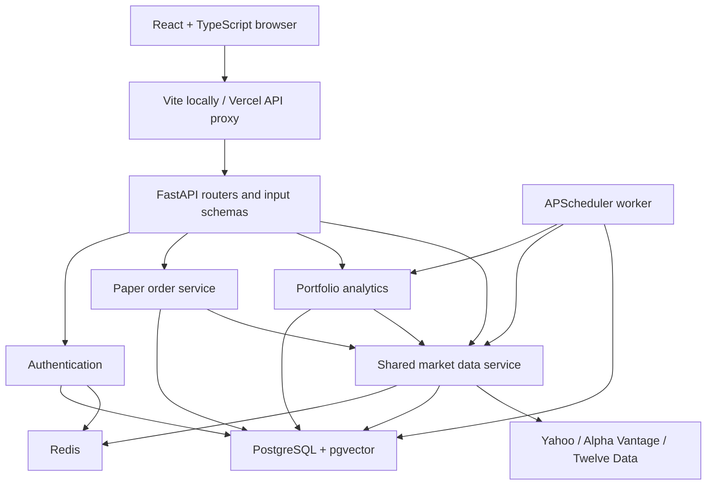
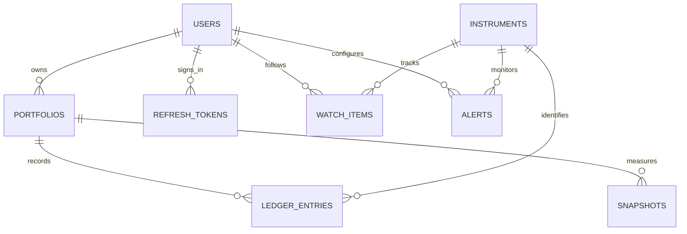

# README 2 — Architecture and beginner's file guide

## The idea in plain language

The browser draws the screens. FastAPI checks who you are and applies the rules. PostgreSQL remembers users, portfolios and transactions. Redis remembers recently fetched prices so many viewers can reuse the same request. A separate worker runs scheduled jobs.

A **router** receives an HTTP request. A **schema** checks its inputs. A **service** performs the work. A **model** describes a database table. A **migration** changes the database structure in a repeatable way.

You do not need to type all the files yourself: they are complete in this project. Keep their folders together and run the commands in README.md from the project root.

## Architecture

The frontend never calls a market provider. Broker and LLM secrets stay on the backend. AI routes retrieve stored headlines through pgvector and call the configured LLM; forecasts are trained by a separate CLI command, keeping expensive training out of an HTTP request.

## How a safe order works

1. The frontend creates an idempotency key for the order. Retrying keeps the same key.
2. The API validates the symbol, side and exact decimal quantity, then checks portfolio ownership.
3. It gets the quote and FX through the shared market service. Stale data stop the order.
4. PostgreSQL locks the portfolio row with `SELECT ... FOR UPDATE`. Another order for the same portfolio waits here.
5. Inside the lock, the service checks the idempotency key again and replays the ledger.
6. A buy must fit the available cash. A sell must fit the held quantity. Shorting is rejected.
7. It appends one ledger entry and one audit event, then commits the transaction.
8. A waiting request now sees the committed balance or the existing order key before doing anything else.

A key is unique **within a portfolio**. Reusing it for a different request returns 409. Both a row lock and a unique database constraint are used; the UI's disabled button is only a convenience.

## Where money lives

`LedgerEntry` is the source of truth. Each entry stores the action, quantity, native price, execution FX rate, INR cash movement, request fingerprint and sequence. A database trigger rejects ledger updates, deletes and truncation. Cash movement must also equal the exact quantity/price/FX product for buys and sells.

Python Decimal and PostgreSQL NUMERIC preserve exact amounts. Monetary columns have no fixed database scale that would silently round them. Accepted quantities have at most eight decimal places. Provider price/FX inputs are finite, positive and bounded to keep multiplication within the 120-digit arithmetic context. Browser charts and money formatting are presentation boundaries.

FIFO means “first in, first out.” The accounting service queues acquisition lots by ledger sequence. A sale removes shares from the oldest lot, then the next lot if needed. Native cost and INR acquisition cost are tracked independently, so exchange-rate changes are reflected in INR P&L.

The balance uses one INR virtual wallet. Currency allocation describes the stock's quote currency; it is not a separate USD cash account.

## Main database relationships

| Table | What it stores | Important rule |
| --- | --- | --- |
| `users` | Email, bcrypt hash or Google subject, demo flag | Unique normalized email; Google accounts are not silently linked by email |
| `refresh_tokens` | Token and CSRF hashes, session family, expiry, revocation | Raw refresh tokens are only in httpOnly cookies |
| `portfolios` | Owner, name, paper/import type | Every private read/write checks the owner |
| `instruments` | Canonical symbol, exchange, currency, sector, provider aliases | Mappings preserve the exchange identity |
| `ledger_entries` | Deposits, buys, sells and imported acquisition lots | Immutable; unique portfolio sequence and idempotency key |
| `quote_records` | Last successful quote/history JSON | Survives Redis loss and is returned as stale when needed |
| `snapshots` | One current daily observation per portfolio/date, benchmark prices and FX | Same-day job retries update the daily observation; ledger history is untouched |
| `watch_items` | User and symbol | Unique user/symbol pair |
| `alerts` | User, symbol, target, direction, trigger timestamp | Triggered only once; stale prices are skipped |
| `import_previews` | Checked rows, expiry and eventual portfolio ID | Confirmation is single-use and retry-safe |
| `broker_connections` | Fernet-encrypted broker token | No token is returned to the frontend |
| `news_documents` | Headline, source URL, publication date, vector | Unique symbol/source URL; 1536-dimensional embeddings |
| `forecasts` | Latest experimental evaluation/prediction JSON per symbol | Demo data, evaluation windows and training time are retained |
| `audit_events` | Action, actor, entity and time | Append-only; no request bodies or secrets |

## File-by-file map

| File or folder | What goes there |
| --- | --- |
| `compose.yaml` | Database, Redis, migration, API, worker, frontend and optional test/load containers |
| `.env.example` | Every supported environment variable, with development defaults and empty integration keys |
| `.github/workflows/ci.yml` | Automated build, lint, database, browser and load checks |
| `backend/pyproject.toml` | Python dependencies, pytest settings and ruff rules |
| `backend/Dockerfile` | Local API/test image; optional PyTorch build argument |
| `backend/Dockerfile.deploy` | Smaller deployment image without test dependencies |
| `backend/alembic.ini` | Migration configuration |
| `backend/alembic/env.py` | Connects Alembic to the configured database and model metadata |
| `backend/alembic/versions/0001_initial.py` | Exact initial DDL, vector extension, integrity constraints and append-only triggers |
| `backend/app/main.py` | App creation, routers, CORS, sanitized errors, structured HTTP metrics and health routes |
| `backend/app/logging_config.py` | Shared JSON application/worker logs and external HTTP log suppression |
| `backend/app/config.py` | Environment loading and production checks |
| `backend/app/db.py` | Database connection pool and request-scoped sessions |
| `backend/app/middleware.py` | Upload body limit before multipart parsing |
| `backend/app/models/entities.py` | SQLAlchemy table definitions |
| `backend/app/models/__init__.py` | Explicit model exports |
| `backend/app/schemas/requests.py` | Validated login, order, import, alert and IPO inputs |
| `backend/app/routers/auth.py` | Registration, login, refresh, logout and Google OAuth endpoints |
| `backend/app/routers/api.py` | Market, trading, analytics, import, metrics, SSE and AI routes |
| `backend/app/routers/broker.py` | Kite authorization, encrypted token storage, holdings preview and disconnect |
| `backend/app/services/security.py` | Password hashes, JWT validation, refresh/CSRF cookies and encryption |
| `backend/app/services/cache.py` | Redis client, atomic quotas, login limits and distributed locks |
| `backend/app/services/catalog.py` | Supported symbols and synthetic demo prices |
| `backend/app/services/providers.py` | Provider HTTP adapters, decimal parsing and request-budget reservation |
| `backend/app/services/market.py` | The only quote/history/FX gateway; caching, fallback and stale behavior |
| `backend/app/services/accounting.py` | Pure FIFO ledger replay; no HTTP or database dependency |
| `backend/app/services/trading.py` | Ownership checks, portfolio lock, idempotency and atomic order execution |
| `backend/app/services/analytics.py` | Portfolio value, INR/native P&L, allocation and benchmark series |
| `backend/app/services/risk.py` | Decimal XIRR, volatility and maximum drawdown |
| `backend/app/services/imports.py` | In-memory file parsing, validation, expiring preview and confirmation |
| `backend/app/services/jobs.py` | Daily portfolio observations and price-alert evaluation |
| `backend/app/worker.py` | Runs APScheduler in a separate process |
| `backend/app/services/insights.py` | News ingestion, embeddings, vector retrieval, cited summaries and fallback |
| `backend/app/services/forecasting.py` | Optional PyTorch training and honest walk-forward evaluation CLI |
| `backend/app/seed.py` | Idempotent catalogue and demo-user setup with a startup advisory lock |
| `backend/app/testing.py` | Creates only the disposable `grow_test` integration database |
| `backend/tests/test_accounting.py` | Golden FIFO case, fractional quantities, FX, full exits and invariants |
| `backend/tests/test_risk.py` | XIRR and drawdown boundary cases |
| `backend/tests/test_trading_integration.py` | Real PostgreSQL concurrent orders, retries, ownership, immutability and golden orders |
| `backend/tests/test_security.py` | Password, rate-limit, precision and input-validation checks |
| `backend/tests/test_api_integration.py` | Refresh rotation/replay, CSRF, sanitized errors and import confirmation |
| `backend/tests/test_market_integration.py` | Provider fallback, cache reuse and stale-value behavior |
| `backend/tests/test_import_files.py` | CSV, XLSX, invalid formats and file-size checks |
| `backend/tests/test_ml.py` | Optional train/test chronology and baseline verification |
| `backend/tests/conftest.py` | Disposable test accounts and PostgreSQL engine fixtures |
| `frontend/package.json` | Exact direct React/Vite/Tailwind/Recharts tooling versions and commands |
| `frontend/tsconfig.json` | Strict TypeScript compilation |
| `frontend/vite.config.ts` | React plugin and local same-origin API proxy |
| `frontend/eslint.config.js` | ESLint, TypeScript and React hook rules |
| `frontend/postcss.config.js` | Tailwind v4 PostCSS integration |
| `frontend/tailwind.config.js` | Content paths; CSS is the main theme source |
| `frontend/index.html` | Browser page and React entry point |
| `frontend/src/main.tsx` | Mounts the React app |
| `frontend/src/App.tsx` | Session bootstrap, navigation, theme, portfolio selector and lazy page loading |
| `frontend/src/Auth.tsx` | Login/register, Google link and seeded demo entry |
| `frontend/src/Overview.tsx` | Portfolio summary, holdings, allocation and performance charts |
| `frontend/src/MarketsTrade.tsx` | Supported stock search, chart, SSE toggle, paper orders and ledger |
| `frontend/src/Tools.tsx` | Watchlist, alerts, import, AI, IPO and metrics pages |
| `frontend/src/api.ts` | One authenticated HTTP client, in-memory access token and refresh coordination |
| `frontend/src/types.ts` | Typed API response shapes |
| `frontend/src/format.ts` | Decimal display formatting and shared error text |
| `frontend/src/ui.tsx` | Original SVG icons, notices, badges and metric cards |
| `frontend/src/styles.css` | Dark/light variables, responsive layout, charts and visual styles |
| `frontend/public/sample-portfolio.csv` | Downloadable sample for the import screen |
| `samples/portfolio.csv` | The same sample for automated/manual tests |
| `e2e/smoke.mjs` | Browser smoke checks and actual screenshot/video capture when run |
| `load/k6.js` | Cached-quote load workload and thresholds |
| `load/summarize.py` | Turns actual k6 output into the README results block |
| `infra/configure_vercel.py` | Writes a real backend proxy configuration after you supply its actual hostname |
| `infra/render.yaml` | API/worker Blueprint; database and Redis are configured separately |
| `infra/start_api.sh` | Deployment migrations, catalogue seeding and API start |
| `docs/` | Validation, security, API, deployment, load and manual-test explanations |

Package `__init__.py` files intentionally have no application logic unless they export models. They are complete empty package markers, not omitted implementations.

## Learn/build in phases

1. **Foundation:** read Compose, `main.py`, `db.py`, the migration and `App.tsx`. Start everything and check `/health` and `/ready`.
2. **Authentication:** follow `Auth.tsx` → `api.ts` → `routers/auth.py` → `services/security.py`. An access token proves identity briefly; a refresh cookie lets the browser renew it.
3. **Market data:** follow `market.quote` → Redis → provider budget → provider adapter → stored last value. The browser has no provider credentials.
4. **Trading:** read the pure golden test before the database order service. Run the two-session PostgreSQL tests to see why the portfolio lock matters.
5. **Analytics:** read `analytics.py`, then `risk.py` and the daily job. Benchmark prices and USD/INR are stored with each snapshot, preventing today's FX from rewriting past benchmark points.
6. **Import — 5B:** a preview is temporary checked data. Confirming creates a new read-only portfolio with `IMPORT` ledger entries. It never edits paper history. A second confirmation returns the same portfolio.
7. **Tier 2:** understand the shared quote cache before SSE. SSE sends cached prices, not a separate feed per browser. Alerts are stored in-app, with no email/SMS dependency.
8. **RAG:** real fetched headlines become stored documents. Embeddings make them searchable by meaning. The response includes only source URLs from those documents. If generation fails, original headlines remain usable.
9. **LSTM:** train separately, split by time, refit preprocessing on past data, and compare the same future horizons with a naive model. No performance claim is made without actual evaluation output.
10. **IPO and shipping:** the manual scenario is `issue price + GMP`, with a zero floor. Run the entire checklist and CI before deployment; the provided manifests are a starting configuration, not a deployment record.

## Assumptions you should understand

- Quantity precision is eight decimal places. No fees, tax calculations or corporate-action processing are implemented.
- Imports capture average cost, not original acquisition dates. Their INR cost uses FX at import time, so imported XIRR is unavailable rather than fabricated.
- Day change compares current holdings against each provider's previous close. It excludes the timing of trades made during the day and is labelled accordingly.
- The daily job observes portfolios at 23:45 IST on weekdays, plus a startup observation on weekdays. Same-day observations are updated by later runs. US markets can still be open at that time; this is not a synchronized global closing-price series.
- Benchmarks are price-only Nifty 50 and S&P 500. S&P 500 is converted to INR using the FX recorded in each observation. Returns are normalized from the first common observation. Future deposits/withdrawals would require cash-flow-adjusted performance; this version provides only an initial virtual deposit and no withdrawal endpoint.
- Redis is required for safe login limits and shared provider budgets. A cache outage makes readiness fail and returns controlled errors; old persisted market data may still be viewed as stale.
- The worker and API share a database and Redis. Redis leases prevent overlapping job runs; one worker is the intended deployment configuration. A worker crash can release the lease only after its TTL expires.
- The initial migration is explicit SQL, not a runtime `create_all()`. A destructive downgrade is deliberately refused; use backups for real data.
